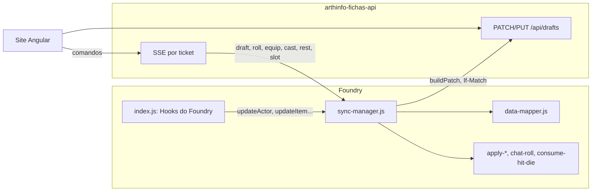

# Mapa do código — arthinfo-fichas-sync

> Gerado pelo Cartographer em 2026-10-30T19:17:04Z. Retrato datado: confira o código antes de confiar em detalhe. Regras e invariantes ficam em [AGENTS.md](../AGENTS.md) e em `../AGENTS.md` do workspace, que prevalecem sobre este arquivo.

Módulo do Foundry VTT (v13 mínimo, verificado na v14), JS puro empacotado pelo Vite. Vincula um Ator a uma ficha do Arthinfo Fichas via `arthinfo-fichas-api`. Não usa Firebase: autentica com a **chave da mesa** (`ra_mesa_...`, setting `mesaKey`).

## Visão geral



## Estrutura

```
src/
├── index.js              settings + todos os Hooks; cria ApiClient e SyncManager no ready
├── sync-manager.js       o coração: overlay, aplicar draft remoto, filas, SSE
├── data-mapper.js        ATTR_MAP e leitores de dados derivados do dnd5e
├── draft-diff.js         buildPatch (PATCH) e allowlist
├── api-client.js         HTTP + SSE com ticket
├── apply-item-equip / apply-item-cast / apply-rest / apply-spell-slot   comandos vindos do site
├── chat-roll.js, consume-hit-die.js     rolagem do site no chat e dado de vida
├── class-hit-points.js   repara avanço de PV da classe (FDD-90)
├── draft-selector.js, draft-link.js, first-link.js   vínculo Ator ↔ ficha
├── image-store.js, portrait.js          imagens por hash (FDD-71)
├── compendium-sync.js, compendium-sync-dialog.js    compêndio da mesa
├── legacy-migration.js, module-id.js    migração do id antigo runarcana-sync
├── cached-spell.js, backend-url.js, sync-utils.js (sem uso)
module.json (raiz)        manifesto publicado; src/module.json é resíduo
vite.config.js            build lib ES -> dist/module.js
```

## Como o sync funciona

### Escrita (Foundry → site)
1. Os hooks de `index.js` (`updateActor`, `createItem`, `updateItem`, `deleteItem`, efeitos ativos) só agem se `userId === game.user.id` e delegam a `handleActorUpdate` / `handleItemUpdate`.
2. Debounce de 1 s e depois uma **fila por ator** (`saveQueues`): o segundo save parte do draft que o primeiro salvou (FDD-36).
3. `writeOnce`: `before = lastKnownDraft`, `base = clone(before)`, aplica o overlay do Ator sobre a base e chama `_persistDraft`.
4. `_persistDraft`: `buildPatch(before, next)`. `null` não chama a API; `UNSUPPORTED` cai em PUT; normal vai por `PATCH` com `If-Match = updatedAt` da base. 404 sem `DRAFT_NOT_FOUND`/405 desliga o PATCH (API antiga); 400/413 caem em PUT; 409 troca a base por `error.current` e reaplica **uma vez**.
5. **Nunca há escrita sem `lastKnownDraft`** (um PUT sem base apagaria `concept`, `identity` e `equipment`, que só o site conhece).

### Leitura (site → Foundry)
SSE: `POST /api/drafts/:id/stream-ticket` e `GET .../stream?ticket=` (a chave nunca vai na URL, FDD-46). Reconexão com backoff de 2 s a 30 s; desiste em 403/404.

| Mensagem | Ação |
|---|---|
| draft (padrão) | anti-eco por `sourceClientId`; senão `_applyRemoteDraft` |
| `roll` | `postSiteRollToChat` e, se `hit-die`, `consumeSiteHitDieRoll` |
| `itemEquip` / `itemCast` / `rest` / `spellSlot` | `apply-*` |

Todos os comandos só rodam no **GM ativo** (`game.users.activeGM`), para um único aplicador. Sem GM conectado, ninguém os aplica.

### Direção dos campos (`ATTR_MAP`)
- **Foundry → site apenas** (`ONE_WAY_FOUNDRY_TO_SITE`): `hp.max`, `movement.walk`, `init.total`, `ac.value`, `spell1..9.max`, `pact.max`, `resources.*.max`, `spell.dc`, `spell.attack`. Já causaram bug real quando o site escrevia valor derivado por cima do Ator.
- **Bidirecional**: `name` ↔ `concept.name` (o nome em branco do site é ignorado por `NON_BLANK_FOUNDRY_PATHS`), `hp.value`, `hp.temp`, moedas, `spell*.value`, `resources.*.value/label`, morte, exaustão.
- **Fora do `ATTR_MAP`**: atributos (`scores + originBonuses`), salvaguardas e perícias (bidirecional); `conditions`, `effects`, `traits`, `foundryIdentity`, retrato e `items[].computed` (só Foundry → site); biografia por `mergeFoundryBiography` (FDD-50); itens bidirecionais pareados por `flags.arthinfo-fichas-sync.sourceId`.
- `hp.*` é ignorado quando `maxHp <= 0` (FDD-90).
- Valores que o dnd5e já calcula (ataque, CD) são lidos de `item.labels` / activity, não de `toObject()`.

### Anti-eco e corridas
- `activeSyncs`: durante `_applyRemoteDraft` os hooks do próprio ator retornam cedo.
- `sourceClientId === apiClient.clientId`: eco da própria escrita só atualiza `lastKnownDraft`.
- `startListening` reserva a vaga em `streams` antes do primeiro `await`.
- Um draft só pode ser ouvido por um Ator (`isDraftClaimedByAnotherActor`).

## Settings e flags (só nomes)

- Settings (`world`): `mesaKey` (recarrega o mundo), `compendiumSyncSelection`; menu `compendiumSyncMenu`. Removidos e apagados na migração: `compendiumSyncKey`, `backendUrl`.
- Flags de Ator: `draftId`, `pendingFirstSync`. De Item: `sourceId`, `catalogKey`. De chat: `rollId`, `kind`.
- API para macros: `game.modules.get('arthinfo-fichas-sync').api` com `openCompendiumSync`, `apiClient`, `syncManager`.

## Migração do id antigo

`runLegacyMigration` roda no `ready` (só GM): apaga settings removidos, copia `mesaKey` e a seleção do compêndio se o novo estiver vazio, move `draftId` dos Atores e `sourceId`/`catalogKey` dos itens. Toda leitura de flag passa por `readFlag` (nunca `getFlag` no escopo legado, que lança erro). O id `runarcana-sync` fica de propósito em `module-id.js` e `legacy-migration.js`.

## Build e release

- `npm run build` gera `dist/module.js`; `dist/` é ignorado pelo git. O `module.json` da raiz declara `esmodules: ["dist/module.js"]`.
- `__BACKEND_URL__` é embutido no build: padrão produção, `BACKEND_URL=... npm run build` troca; `vite` (dev) usa `localhost:3000`.
- Versão = nº de commits (odômetro de 100), via `scripts/sync-version.mjs` (`--print` calcula o valor de build). Não editar à mão.
- CI (`.github/workflows/ci.yml`): lint, testes, build, `test:version`. **O workflow que empacota `module.zip` e cria o release não está no repo.**

## Convenções

- Vitest, `*.spec.js` ao lado da fonte; ambiente `node` (todos os globais do Foundry são fakes por spec, sem helper compartilhado).
- ESLint com `--max-warnings 6` (catraca: só baixar).

## Gotchas

1. **Debounce global.** `debounce` em `sync-manager.js:33` guarda um único `timeout` para todos os atores: duas fichas editadas dentro de 1 s se cancelam e só a última envia. Confirmado no código.
2. **Docs desatualizadas.** README e AGENTS.md dizem que `actor.name` não sincroniza; o `ATTR_MAP` tem `name` bidirecional. O README também fala em PUT, mas o fluxo real é PATCH com fallback.
3. **Código morto.** `src/sync-utils.js` (`mergeActivities`, `compareItems`...) não é importado por nenhum arquivo. O `DATA_CONTRACT_ACTIVITIES.md` descreve preservação de activities que o código atual não implementa visivelmente (existe `sanitizeActivities`).
4. **PATCH vira PUT em silêncio** quando o overlay escreve campo fora da allowlist de `draft-diff.js`. Ao criar campo novo, atualizar a allowlist junto com `arthinfo-fichas-api/src/draft-patch.js`.
5. **`src/module.json` é resíduo** (1.0.0, compat 11/12, `main`); não entra no build.
6. **Cache de magia do dnd5e** (`flags.dnd5e.cachedFor`) é excluído nos dois sentidos (FDD-117).
7. **`_applyRemoteDraft` só apaga itens locais que têm `sourceId`**; itens nativos do Foundry ficam.
8. **`hd.classes` é Collection do Foundry**: não usar `Array.isArray`.
9. Imagens: `crypto.subtle` só existe em localhost ou https; em falha o draft usa o caminho do Foundry.

## Lacunas de teste (aparentes, não medidas por cobertura)

- `index.js` e todos os hooks não têm teste.
- `sync-utils.js` sem spec (e sem uso).
- Anti-eco (`sourceClientId`) e `activeSyncs`, debounce e `handleActorUpdate`/`handleItemUpdate` sem teste.
- `_applyRemoteDraft` completo (create/update/delete de item, perícias e atributos site → Foundry, `seedFromActor`) só é exercitado de lado.
- `rest` e `spell-slot` não são testados no nível do manager.
- `compendium-sync.js` (lotes, limpeza, erros), `backend-url.js` e `api-client` (`missingImages`, `uploadImages`, 429) cobertos só em parte.
- Os fakes do Foundry nunca foram validados contra o Foundry real; só o VTT fecha issue de sync.

## Guia de navegação

| Tarefa | Onde mexer |
|---|---|
| Novo campo sincronizado | `ATTR_MAP` em `data-mapper.js` (**decidir a direção**), overlay e pull em `sync-manager.js`, allowlist em `draft-diff.js` e na API |
| Novo comando vindo do site | evento SSE em `api-client.js`, despacho em `startListening`, novo `apply-*.js` (só GM ativo) |
| Valor calculado pelo dnd5e | leitor em `data-mapper.js` (`labels`/activity), campo one-way |
| Novo hook do Foundry | `index.js` (filtrar `userId`) |
| Vínculo Ator ↔ ficha | `draft-selector.js`, `draft-link.js`, `first-link.js` |
| Release | `scripts/sync-version.mjs --print`, `BACKEND_URL`, `module.json` da raiz |
